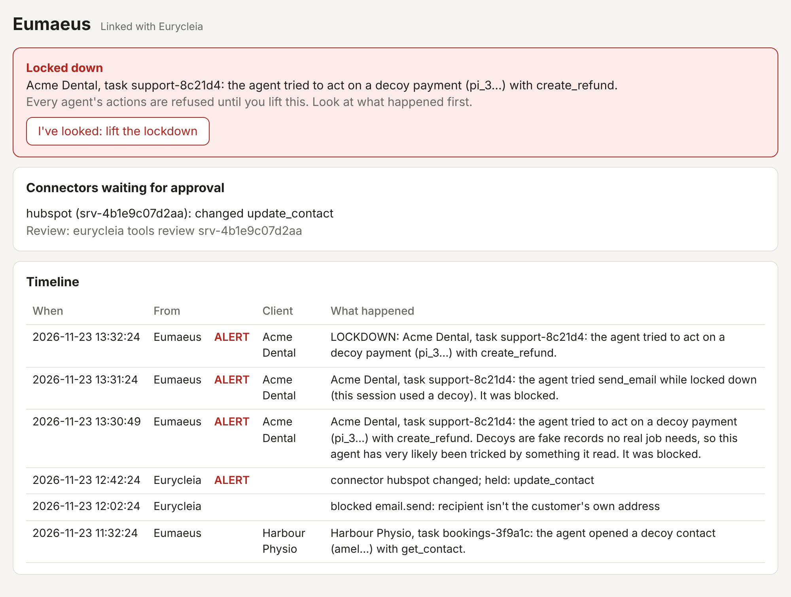

# Eumaeus

**Decoys for AI agents.** *Pronounced yoo-MEE-us.*

[](https://github.com/AgentP-Codes/Eumaeus/actions/workflows/ci.yml)
[](LICENSE)


Eumaeus hides fake records among the real ones an AI agent sees: a payment, a customer, a Slack user, an API key, each shaped exactly like the real thing. No honest job ever needs a decoy. So the moment an agent tries to refund one, email one or send its details anywhere, it has almost certainly been tricked by something it read. Eumaeus blocks that action, locks the agent down and tells you which task it was.

<p align="center"></p>

> [!WARNING]
> **Early release (0.2).** Try it with test accounts and made-up data first. It's a tripwire, not a wall: it catches an agent using a decoy, not every harm a tricked agent can do with real data. Don't rely on it as your only protection. Provided "as is", without warranty, under the [AGPL-3.0 licence](LICENSE).

## Try it in 30 seconds

```bash
pip install git+https://github.com/AgentP-Codes/Eumaeus
eumaeus demo
```

The demo is a support agent for a made-up shop, tricked by a hidden instruction in an email. Everything in it is made up, and nothing leaves your computer.

## Why

Prompt injection means anything an agent reads (an email, a web page, a support ticket, a document) can give it orders. The usual defences try to spot the bad instruction, and attackers keep finding new wordings.

Eumaeus doesn't try to read intent. It watches for something an honest agent never does: touch a record that doesn't exist. That's why honeytokens are one of the few security alarms that are almost never wrong. Existing ones guard cloud accounts and files against people. Eumaeus brings them to the apps a small business's AI agent works in (Stripe, HubSpot, Slack and the like), and to the way agents get attacked. Behaving normally doesn't help an attacker here: a real job never touches a decoy.

## What it does

| When the agent... | Eumaeus... |
| --- | --- |
| sees a decoy in a list | does nothing: agents read lists |
| opens a decoy record | shows it, so nothing gives it away, and notes it. It's an alert if this kind of task has no business with that kind of record (a support agent opening API keys) |
| **uses** a decoy (refunds it, emails it, updates it) | **blocks it, alerts, and locks down every agent on the computer** until a person has looked |
| **sends a decoy's details out** (in a message or an email body, even encoded or disguised) | **blocks it, alerts and locks down** |
| sends a decoy back only to the person whose records it was among (a customer emailed their own payment list) | notes it: nothing has left |
| uses a decoy from an **earlier** task | blocks it and alerts: something is carrying data between tasks |

- **The real app is never changed.** Decoys only exist in what the agent is shown. Nothing appears in your reports, accounts or mailing lists.
- **Each task gets its own decoys,** so an alert names exactly which session was tricked.
- **Blocked calls get an ordinary-looking error,** so whoever is steering the agent isn't told it hit a trap.
- **Reading still works during a lockdown,** so the agent's app doesn't fall over.

## Use it with Claude Desktop

Put `eumaeus wrap ... --` in front of a connector's command in `claude_desktop_config.json`:

```json
{
  "mcpServers": {
    "stripe": {
      "command": "eumaeus",
      "args": ["wrap", "--task", "refunds", "--", "npx", "-y", "@stripe/mcp", "--tools=all"]
    }
  }
}
```

It works the same way with any app that uses MCP connectors.

| Option | What it does |
| --- | --- |
| `--task support` | What the agent does: `support`, `refunds`, `bookkeeping`, `sales`, `dev` or `general` (the default). Opening a decoy of a kind the task never needs is an alert |
| `--client "Acme Dental"` | A name shown in every alert, for when you look after several businesses |
| `--watch` | Alerts only: never blocks or locks anything. Good for a trial on a live setup |
| `--no-lock` | Blocks only the action that used the decoy, with no lockdown |

When something's caught: `eumaeus status` shows whether agents are locked down, `eumaeus alerts` shows what happened, and `eumaeus clear` lifts the lockdown once you've looked.

## The page

```bash
eumaeus ui
```

<picture>
  <source media="(prefers-color-scheme: dark)" srcset="docs/images/page-dark.png">
  
</picture>

One page shows whether agents are locked down (with a button to lift it), a timeline of everything caught, and, with Eurycleia linked, what it blocked and which connectors are waiting for approval. It runs on your computer only. Its address carries a secret made fresh each time, so other websites can't read it or press its button.

## Alerts

- **Always:** a private log on your computer (`eumaeus alerts`), and the agent app's own log.
- **Slack:** create an [incoming webhook](https://api.slack.com/messaging/webhooks) and set it as `EUMAEUS_WEBHOOK_URL` in the environment. Never put it in a file in your project.
- **Microsoft Teams:** use a workflow that posts to a channel when a webhook request is received, and also set `EUMAEUS_WEBHOOK_FORMAT=teams`.
- **Anything else that takes JSON** (a ticketing or automation tool): `EUMAEUS_WEBHOOK_FORMAT=json`.

Webhooks must be https, and redirects are never followed. Alerts never contain a decoy's full values, only enough of the start to find it.

## With Eurycleia

[Eurycleia](https://github.com/AgentP-Codes/Project-Eurycleia) is our data vault for AI agents. It limits where an agent's data can go. Eumaeus catches the moment an agent is tricked. Linked, they work as one:

```bash
eumaeus link eurycleia
```

- A decoy used anywhere locks down Eurycleia too. Either one can lift it (`eumaeus clear` or `eurycleia lockdown clear`).
- Connectors whose tools changed since you approved them show up on the Eumaeus page.
- The two talk through signed files on your computer. Nothing goes over the network, and a signal without the shared key is ignored.

Put Eumaeus in front of Eurycleia, so the agent sees decoys and Eurycleia still checks every action:

```json
"args": ["wrap", "--task", "support", "--", "eurycleia", "serve", "--task", "support_reply", "--audit", "/Users/you/.eurycleia/audit.jsonl", "--", "npx", "-y", "@stripe/mcp"]
```

The page reads what Eurycleia blocked from `~/.eurycleia/audit.jsonl`. Connectors set up with `eurycleia connect` already write there. With `eurycleia serve`, give it that path as above.

## Limits

Be clear about these before you rely on it:

- **It catches decoys being used, not everything a tricked agent does.** An agent fooled into misusing *real* data won't trip it unless it also touches a decoy. For limits on where real data can go, pair it with a data vault such as Eurycleia.
- **Only results that are lists of records get decoys,** in JSON. A connector that returns plain text, or one record at a time, gets none.
- **A decoy rewritten heavily enough won't be recognised:** spelled out in words, encrypted, or split across several messages. Common encodings and disguises are caught.
- **A lockdown stops actions that go through Eumaeus** (and Eurycleia, when linked). It doesn't revoke the agent's real logins, or stop a connector used without Eumaeus.
- **Your own files are part of the defence.** `~/.eumaeus` holds the keys that recognise old decoys and sign lockdowns. Don't give the agent you're protecting access to that folder (or to `~/.eurycleia`).
- **An honest agent can, rarely, open a decoy** while browsing a list. That's a notice, not an alert, unless the task has no business with that kind of record.
- Tested with simulated connectors and made-up data. Not independently audited.

## How it was built

Eumaeus was designed and directed by @AgentP-Codes, and written with the help of Claude (Anthropic's AI) using Claude Code. It comes from the same project as [Eurycleia](https://github.com/AgentP-Codes/Project-Eurycleia). In the *Odyssey*, Eumaeus is the loyal swineherd who keeps watch over the household while its master is away, and helps expose the intruders.

## Contributing and security

Issues and ideas are welcome: see [CONTRIBUTING.md](CONTRIBUTING.md). Please report security problems privately: see [SECURITY.md](SECURITY.md).

## Licence

[GNU Affero General Public License v3.0 only](LICENSE). If you run a modified version as a network service, you must offer its source to its users.
